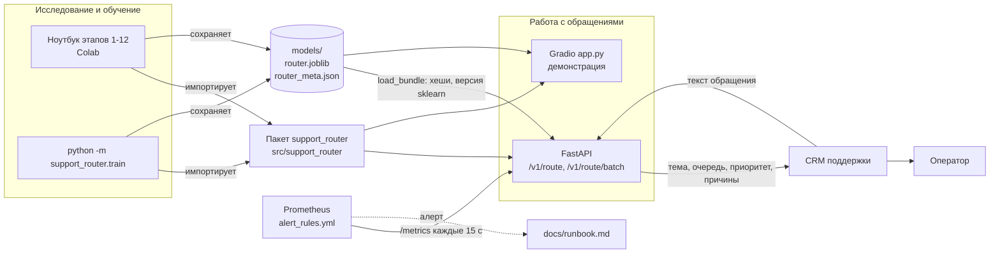
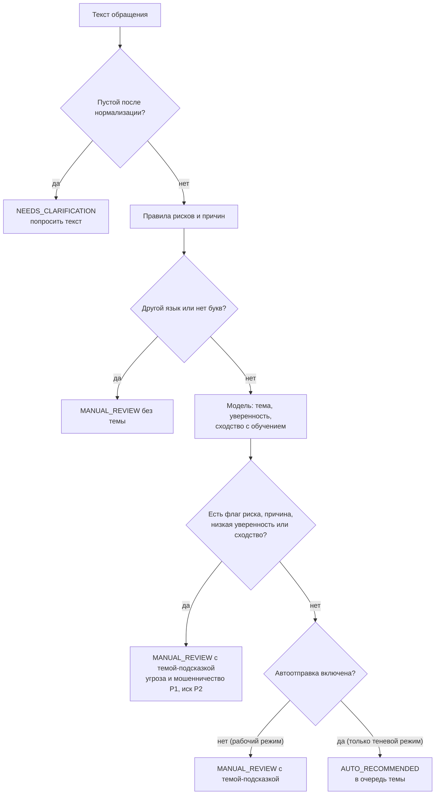
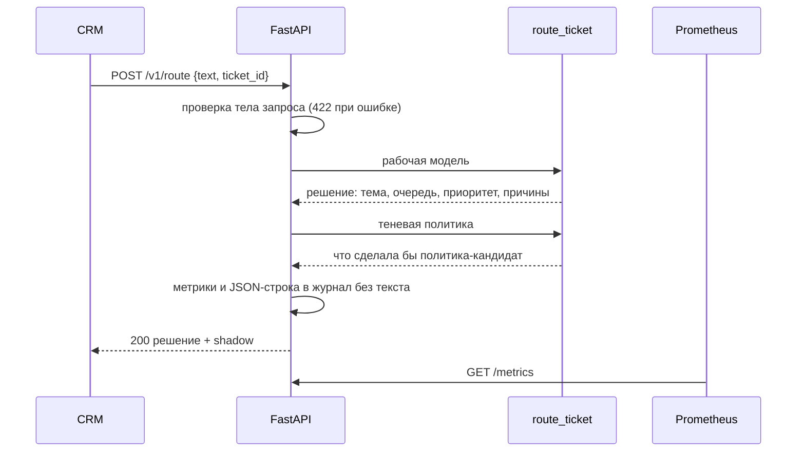
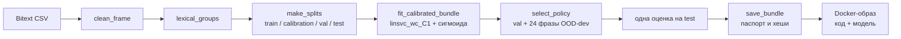

# Архитектура

Система состоит из четырёх частей: пакета `support_router` с логикой, обученной модели с паспортом, двух способов обратиться к модели (HTTP-сервис FastAPI и демонстрационный интерфейс Gradio) и мониторинга на Prometheus. Ноутбук этапов 1-12 и скрипт обучения пользуются тем же пакетом, поэтому решение по обращению везде принимает одна и та же функция `route_ticket`.

## Компоненты и связи

CRM сама решает, куда положить обращение: сервис только подсказывает. Автоотправка выключена политикой модели, поэтому в рабочем режиме каждое обращение уходит оператору с темой-подсказкой, а поле `shadow` в ответе показывает, что сделала бы политика-кандидат.

## Модули пакета

| Модуль | Что делает | От чего зависит |
|---|---|---|
| `config` | версии, 11 тем и их очереди, флаги Bitext | ничего |
| `text` | нормализация текста (`preprocess`), разбор флагов | `config` |
| `utils` | хеши файлов, JSON без NaN, версии пакетов | ничего |
| `data` | очистка датасета, группы похожих фраз, разбиение без утечки | `config`, `text` |
| `models` | 11 конфигураций, обучение, откалиброванный `RouterBundle` | `config`, `text` |
| `evaluation` | метрики, LOIO, бутстреп, метрики маршрутизации | `config`, `models` |
| `rules` | правила рисков и причин ручной проверки | `text` |
| `multiple_requests` | выделяет отдельные просьбы в англоязычных обращениях при включённом режиме | `config`, `text` |
| `routing` | `route_ticket`, пакетная обработка, выбор политики, теневой режим | `config`, `text`, `models`, `rules`, `multiple_requests`, `evaluation` |
| `artifacts` | сохранение модели с паспортом и проверяемая загрузка | `config`, `utils` |
| `explain` | вклад слов в линейную часть модели | ничего |
| `paths` | папки проекта, модели и энкодера: `SUPPORT_ROUTER_HOME`, `SUPPORT_ROUTER_MODELS_DIR`, `SUPPORT_ENCODER_DIR` | ничего |
| `train` | обучение итоговой модели вне ноутбука | всё выше |
| `api`, `monitoring` | HTTP-сервис и метрики Prometheus | `routing`, `artifacts` |
| `scenario_data`, `manual_cases`, `category_examples`, `semantic_encoder` | наборы фраз этапов 1-9 и энкодер MiniLM | `paths` |

Код этапов 1-9 перенесён из `support_core.py` дословно, по функциям. Менялись только импорты, путь к папке энкодера и то, какой код хешируется в паспорте модели: раньше весь `support_core.py`, теперь модули решения. Модель после переноса та же: скрипт обучения дал вероятности, совпадающие с моделью из ноутбука до последнего знака на 3 442 фразах.

## Как принимается решение

Базовый порог уверенности подбирается на val. Модуль `business` применяет дополнительный порог по цене ошибочной очереди и вычисляет приоритет. Для обычного однотемного обращения, которое не проходит порог уверенности или сходства, модуль `cascade` вызывает локальный энкодер MiniLM и откалиброванный классификатор. Оператор видит источник подсказки. [Подробное описание алгоритма](business_policy.md)

## Путь одного запроса

## Обучение и выпуск модели

`save_bundle` записывает в паспорт модели хеш файла, версию scikit-learn и общий хеш модулей решения (`config`, `text`, `models`, `rules`, `routing` и двух вспомогательных). `load_bundle` при старте сервиса сверяет всё это и отказывается загружать модель, если что-то не совпало: так модель не начнёт тихо решать иначе, чем проверенная. Правка `api.py`, `monitoring.py`, `train.py`, `data.py` или `evaluation.py` переобучения не требует.

## Развёртывание

`docker compose up --build` поднимает два контейнера: сервис (образ `python:3.12-slim`, внутри код и модель, пользователь без прав root, проверка `/health`) и Prometheus с правилами алертов. Масштабировать можно запуском нескольких экземпляров сервиса за балансировщиком: состояние между запросами не хранится, метрики собираются с каждого экземпляра отдельно.

## Данные и безопасность

- Текст обращения не попадает ни в журнал, ни в метрики; в ответе на ошибку 422 он не повторяется.
- Контекст CRM (VIP, повторное обращение, сроки) в публичном API не принимается: по замыслу этапов 8-9 он приходит только от доверенного адаптера CRM.
- `joblib` загружает pickle, поэтому сервис открывает только модель, собранную в этом же проекте; хеш рядом с файлом защищает от порчи, но не от подмены.
