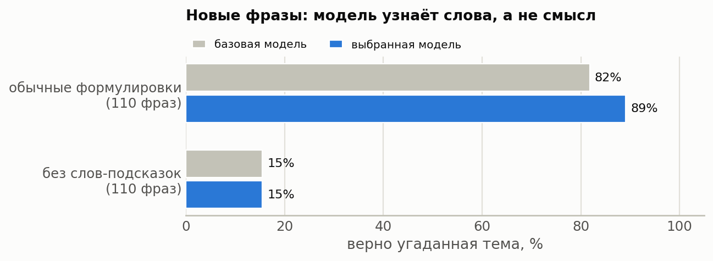
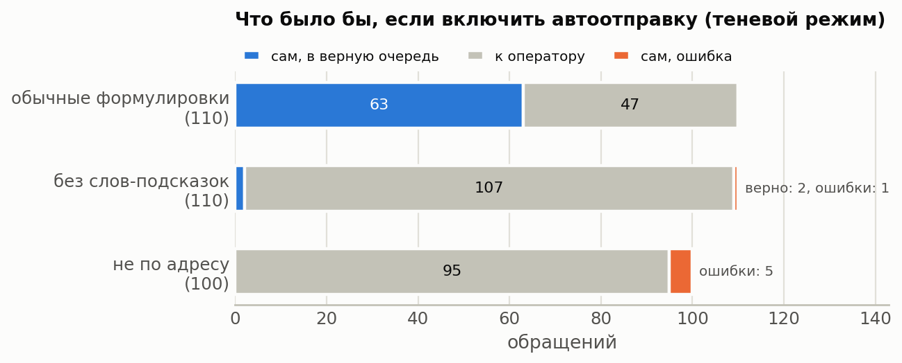

# Результаты прогона

Модель `linsvc_wc_C1`, номер `router-937116a8646a48e3`, код версии 3.1.2. Отчёт собран ноутбуком
из `reports/results.json`; как устроен проект и как его запустить, описано в `README.md` и `docs/`.

## Данные

21 534 обращения Bitext,
после очистки 19 700. Похожие фразы объединены в 3 646
групп; части выборки: обучение 11 970,
калибровка 2 240, выбор порога 2 368, test 3 122.

## Выбор модели (LOIO, 25 интентов)

| Конфигурация | LOIO |
|---|---|
| linsvc_wc_C1 | 81.8% |
| semantic_lr_C1 | 79.7% |
| semantic_aug_lr_C1 | 79.7% |
| semantic_svc_C1 | 76.1% |
| linsvc_w_C0.5 | 72.6% |
| linsvc_w_C1 | 72.0% |
| linsvc_w_C3 | 71.8% |
| lr_word (baseline) | 68.6% |
| sgd_w_a1e-4 | 62.0% |
| sgd_w_a5e-5 | 59.3% |
| sgd_w_a2e-5 | 58.8% |

## Качество

| Проверка | Выбранная модель | Базовая |
|---|---|---|
| Test Bitext, 3 122 фразы | macro-F1 0.9963, ошибок 10 | macro-F1 0.9935, ошибок 16 |
| LOIO, 25 интентов | 81.8% | 68.6% |
| Новые фразы обычными словами, 110 | 98 (89.1%) | 90 (81.8%) |
| Новые фразы без слов-подсказок, 110 | 17 (15.5%) | 17 (15.5%) |

## Что было бы при включённой автоотправке (теневой режим)

Пороги: уверенность не ниже 0.85, сходство с обучением не ниже 0.45.

| Набор | Рабочий режим: сам | Теневой: сам, верная очередь | Теневой: сам, ошибка | Теневой: к оператору |
|---|---|---|---|---|
| Test Bitext, 3 122 | 0 | 3 062 | 6 | 54 |
| Новые фразы, 220 | 0 | 65 | 1 | 154 |
| Не по адресу, 100 | 0 | не бывает | 5 | 95 |

## Тестирование

Автотестов 221: прошли 221, упавших нет, 0 записаны как известные
пропуски правил рисков. На 21 689 фразах проекта правка правил риска
версии 3.1.2 изменила флаги у 0 фраз. Что осталось открытым:

- Без слов-подсказок модель угадывает тему в 17 из 110 фраз, базовая столько же (ограничение модели). TF-IDF узнаёт слова, а не смысл. Защищает порог: теневой режим отправил бы сам только 3 из 110 таких фраз, остальные ушли бы оператору.
- Две темы в одном обращении: правило сработало на 5 из 15, теневой режим отправил бы сам 3 (открыто). Не исправлено: расширение словаря тем меняет отбор обращений для порога на этапе 7. В рабочем режиме такие обращения всё равно видит оператор.
- Сбои сайта и приложения: правило сработало на 1 из 15 (открыто). Не исправлено: слова вроде error встречаются и в обычных вопросах об оплате. Из этих обращений все 15 всё равно ушли бы к оператору: 1 по правилу, остальные потому, что модель не уверена или фраза не похожа на обучающие.
- Другой язык распознан в 7 из 15: правило знает только несколько алфавитов и десяток слов (открыто). Не исправлено, для сервиса нужен настоящий определитель языка. Из этих обращений все 15 всё равно ушли бы к оператору: 7 по правилу, остальные потому, что модель не уверена или фраза не похожа на обучающие.
- Теневой режим отправил бы сам 5 из 100 обращений не по адресу и 1 из 220 обычных в чужую очередь (учтено). Автоотправка остаётся выключенной, как решили на этапе 7: сначала реальные обращения (не меньше 300 по темам и 200 не по адресу) и согласование с бизнесом.
- Короткие и неоднозначные фразы: «I can't log in» модель относит к INVOICES, шаблон {{Order Number}} к PAYMENT, «I do not want a refund…» к REFUNDS (ограничение модели). Уверенность у таких ответов низкая, поэтому даже теневой режим отдаёт их оператору. Лечится данными, а не правилами.
